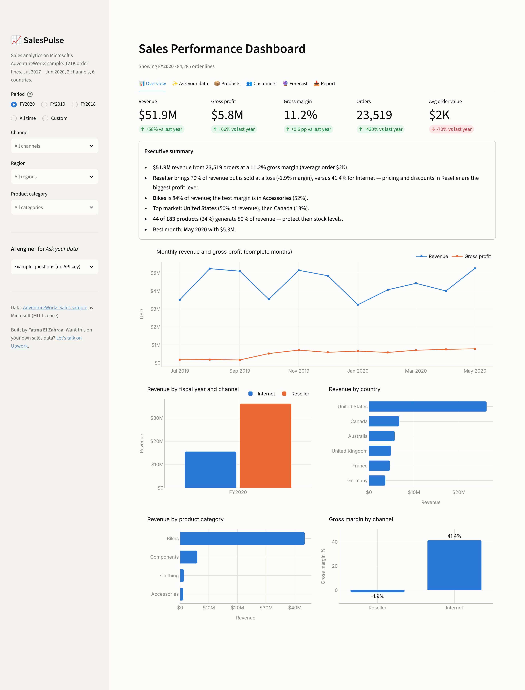
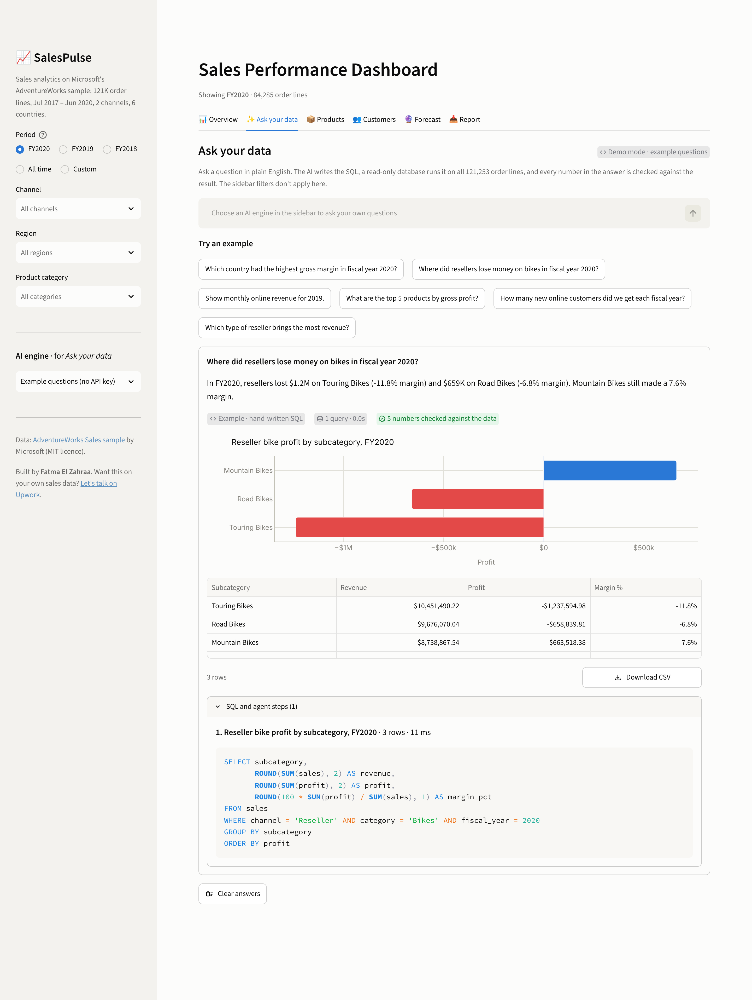
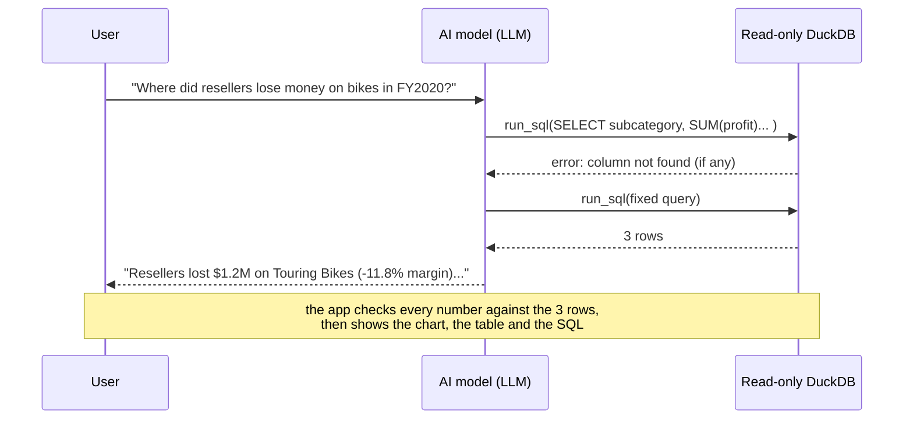
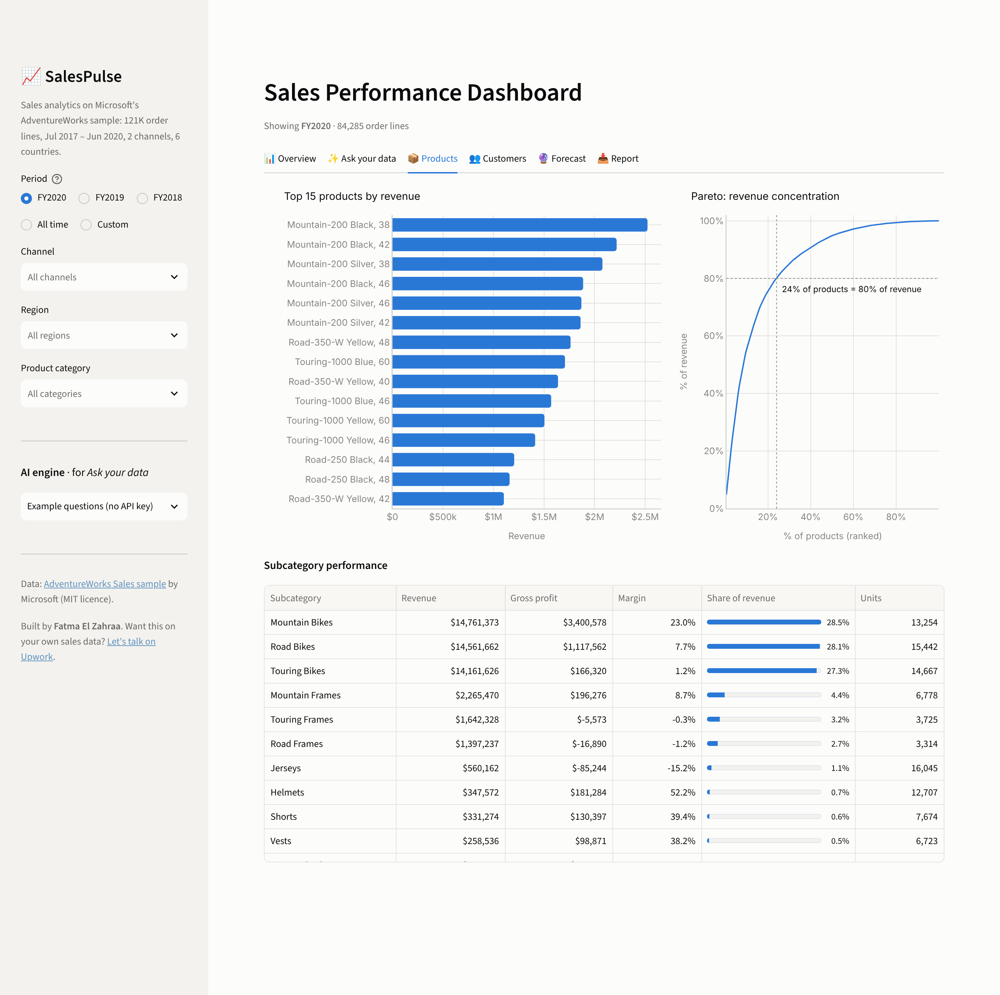
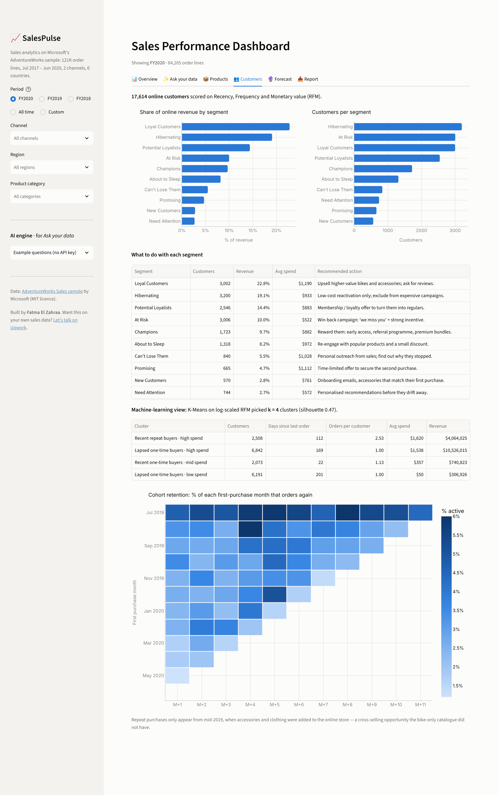
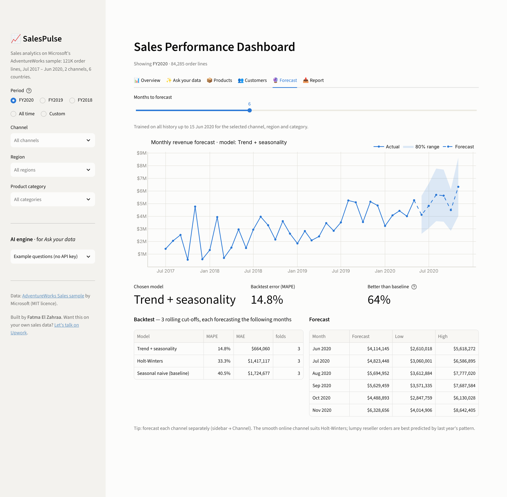
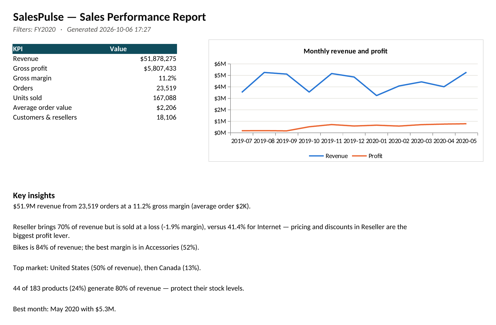

# SalesPulse — AI Sales Analytics: Ask Your Data, Forecasting & Customer Segmentation


An interactive sales dashboard built on **121,253 real order lines** from Microsoft's AdventureWorks
sample (the dataset Power BI uses in its tutorials). It answers the questions a sales director asks every
week — *How are we doing? Where does the profit come from? Which customers should we call? What will next
quarter look like?* — and exports a client-ready **Excel report with native charts**.

For everything the dashboard doesn't show, there is **Ask your data**: type a question in plain English and
an **AI analyst** (Google Gemini on its free tier, OpenAI, Groq or a local Ollama model) writes the SQL, a
read-only database runs it, and the answer comes back with a chart, the table and the query behind it.
**Every number in the answer is checked against the query result**, so a made-up figure can't slip through.



## Highlights

| | |
|---|---|
| ✨ **Ask your data (AI)** | Questions in plain English → SQL → answer, chart and table. The model uses **function calling** to run queries, gets database errors back so it can fix its own SQL, and can run several queries for one question. Follow-up questions get the previous answer as context |
| 🛡️ **Safe by design** | The AI only gets a locked, read-only copy of the data: one `SELECT` at a time, no file, network or settings access, a time limit and a row limit per query |
| ✅ **Numbers you can trust** | Each number in the answer ($1.2M, 27.1%, 2,030 orders) is matched against the query results, allowing for rounding. Anything the model calculated on its own is flagged |
| 📊 **KPIs with YoY deltas** | Revenue, gross profit, margin, orders, average order value — compared with the same period last year |
| 🧠 **Executive summary** | Plain-English insights computed from the data (nothing hard-coded) |
| 📦 **Product analytics** | Top products, Pareto 80/20 analysis, subcategory margins |
| 👥 **Customer segmentation** | RFM scoring into 10 business segments with a recommended action each, plus **K-Means** clustering (k chosen by silhouette score) |
| 🔁 **Cohort retention** | Heatmap of repeat purchases by first-purchase month |
| 🔮 **Forecasting** | 3 models (seasonal naive, Holt-Winters, trend + seasonality regression) compared with a **rolling-origin backtest**; the best one forecasts with an error-based 80 % range |
| 📥 **Excel report** | One-page summary + monthly, category, country, product, segment and forecast sheets with editable Excel charts |
| 🎛️ **Filters** | Fiscal year / custom dates, channel, region, product category — every chart reacts |
| 🧪 **Tested** | 62 automated tests: analytics on hand-made and real data, SQL safety, the AI tool loop with a scripted model and over HTTP, the number check and the app itself |

## Ask your data





* **How the model knows the data:** the prompt describes the `sales` table column by column, including business
  rules a model can't guess (fiscal years start in July, count orders with `COUNT(DISTINCT order_id)`, reseller
  rows have no consumer). The data itself never goes into the prompt, only query results.
* **Why SQL:** the database does the arithmetic, the model writes the query and explains the result. The final
  table and every query are shown, so an analyst can check or reuse them.
* **Without an API key** the tab runs six example questions with hand-written SQL, so the demo always works.
  Pick *Google Gemini (free tier)* in the sidebar and paste a free key from
  [aistudio.google.com](https://aistudio.google.com/apikey) to ask your own questions.
* **From the terminal:** `python -m salespulse examples`, or
  `python -m salespulse ask "Which product lost the most money in 2019?" --provider gemini`
  (reads `GEMINI_API_KEY`).

Questions to try: *Which country had the highest gross margin in FY2020? · Show monthly online revenue for
2019 · Top 5 products by gross profit · How many new online customers did we get each fiscal year?* and then a
follow-up such as *And in Germany?*

## What the data says (FY2020)

* **Reseller sales are 70 % of revenue but were sold at a loss (−1.9 % margin)**, while the online store
  runs at 41 % — pricing and discounts for resellers are the biggest profit lever.
* **24 % of products generate 80 % of revenue** (Mountain-200 bikes lead).
* **Repeat purchases only started in mid-2019**, when accessories and clothing were added online: the
  cohort heatmap shows 2–6 % of customers ordering again every month from then on.
* For total revenue, the trend + seasonality model cut forecast error by **64 %** versus the
  "same month last year" baseline (MAPE 14.8 % vs 40.5 %). For the lumpy reseller channel, last year's
  pattern stays the best predictor — the dashboard says so instead of hiding it.

## Screenshots

| Products & Pareto | Customer segments & cohorts |
|---|---|
|  |  |

| Forecast with backtest | Excel report (page 1) |
|---|---|
|  |  |

## Quick start

**Windows:** double-click `run_windows.bat` · **macOS / Linux:** `./run_mac_linux.sh`

**Manual:**

```bash
python -m venv .venv
.venv\Scripts\activate          # Windows   (macOS/Linux: source .venv/bin/activate)
pip install -r requirements.txt
streamlit run app.py
```

The cleaned dataset ships with the repo (`data/sales.parquet`, 2.3 MB), so the dashboard works offline.
To rebuild it from Microsoft's original workbook: `python scripts/build_dataset.py`.

**AI key (optional):** paste it in the sidebar, or copy `.streamlit/secrets.toml.example` to
`.streamlit/secrets.toml` and fill in `GEMINI_API_KEY` (on Streamlit Community Cloud, paste the same line
into *App settings → Secrets*). The secrets file is git-ignored; never commit a key.

## Methodology

**Data preparation** (`salespulse/data.py`) — joins the star schema (sales fact + date, product, customer,
reseller, territory and order dimensions), replaces `[Not Applicable]` placeholder keys with real nulls,
parses integer date keys, computes profit, and validates business rules (unique order lines, no negative
sales, profit = sales − cost). The last month is partial (data stops on 15 June 2020), so monthly trends
and forecasts stop at the last *complete* month.

**AI analyst** (`salespulse/sql.py`, `salespulse/analyst.py`) — DuckDB in memory with external access,
Python object scans and configuration changes switched off; statements are parsed before they run and only
a single `SELECT` is accepted. The agent loop gives the model one tool, `run_sql`, returns errors as tool
results so it can correct itself, and stops after 6 model calls. The number check reads $, K/M/B and %
formats, ignores years, dates and numbers inside product names, and allows for the rounding of the number
as written.

**RFM segmentation** (`salespulse/segmentation.py`) — Recency, Frequency and Monetary value are scored
1–5 by quintile (ranked first, so the many one-order customers can still be split), then mapped to the
standard RFM grid: Champions, Loyal, Potential Loyalists, New, Promising, Need Attention, About to Sleep,
At Risk, Can't Lose Them, Hibernating.

**K-Means** — log-transformed, standardised RFM features; k from 3–6 picked by silhouette score; clusters
named automatically from their averages (e.g. *Recent repeat buyers · high spend*).

**Forecasting** (`salespulse/forecast.py`) — three candidates are evaluated with a rolling-origin backtest
(3 cut-offs × 6 months, MAPE and MAE). The winner forecasts the next months; the 80 % range comes from the
winner's own backtest errors, so uncertainty is shown honestly.

```
salespulse/
├── data.py          # build + validate the flat sales table
├── metrics.py       # filters, KPIs, YoY, breakdowns, Pareto
├── segmentation.py  # RFM, K-Means, cohort retention
├── forecast.py      # models, backtest, forecast with range
├── insights.py      # executive summary sentences
├── report.py        # Excel report with native charts (xlsxwriter)
├── sql.py           # locked, read-only DuckDB for AI-written SQL
├── analyst.py       # AI analyst: tool loop, number check, chart choice, examples
├── llm.py           # one client for Gemini, OpenAI, Groq and Ollama
└── __main__.py      # command line: python -m salespulse ask "..."
app.py               # Streamlit dashboard
scripts/             # dataset rebuild, screenshots
tests/               # 62 tests
```

## Tests

```bash
pip install -r requirements-dev.txt
pytest
```

The AI tests need no API key: they use a scripted model and a small fake OpenAI-compatible server.

## Data & licence

Data: [AdventureWorks Sales sample](https://github.com/microsoft/powerbi-desktop-samples) © Microsoft,
MIT licence (see `data/README.md`). AdventureWorks is a fictional company. Code: MIT.

---

Built by **Fatma El Zahraa** — Data Scientist & ML Engineer.
Need a dashboard, a forecast, a customer segmentation or an AI assistant that answers questions about your own
data (Excel, SQL, Shopify, CRM exports)? [Contact me on Upwork](https://www.upwork.com/freelancers/~01f79195ceec502c59).
